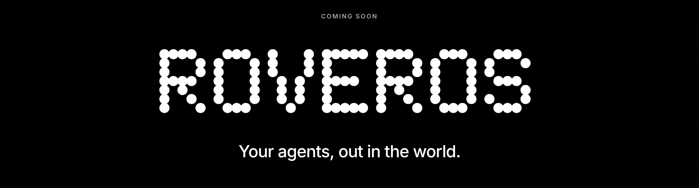
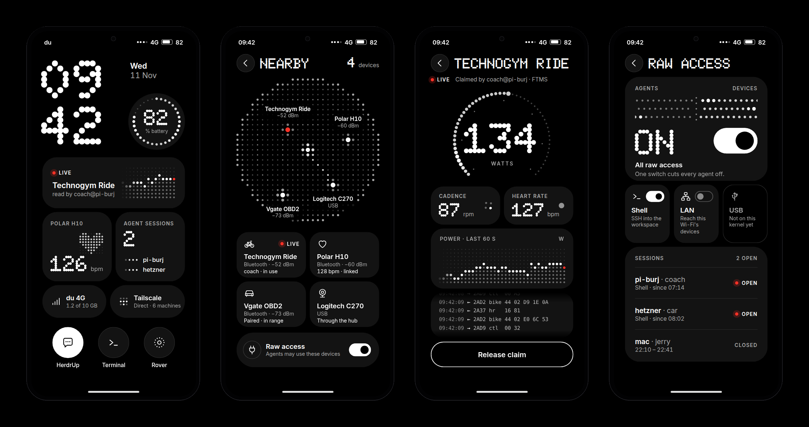
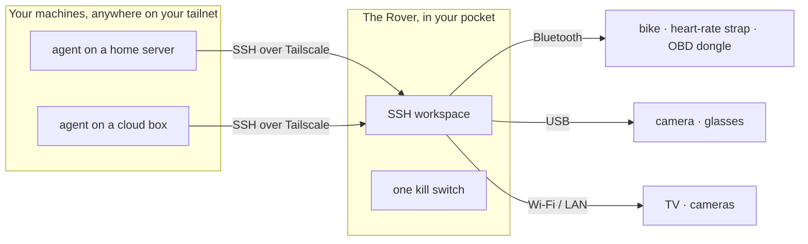

<p align="center">
  
</p>

<p align="center">
  <b>An operating system that turns a pocket phone into a field device for your AI agents.</b><br>
  Your agents live on your servers. The Rover goes where you go, and lets them touch the world around you.
</p>

<p align="center">
  <a href="#status">Status: building in public</a> ·
  <a href="docs/DESIGN.md">Design</a> ·
  <a href="#build-it">Build it</a> ·
  <a href="docs/FLASHING-SWEET.md">Flash a phone</a> ·
  <a href="LICENSE">Apache-2.0</a>
</p>

---

In 2014 a video game imagined a phone that could read a whole city. RoverOS is
the real, smaller, useful version: a phone that stays on your private network
and hands your agents the devices near it.

You get on the bike. An agent on your home server SSHes into the Rover in your
pocket, connects to the bike and the heart-rate strap over Bluetooth, and
coaches you through the ride. Later the engine light comes on; another agent
reads the car's diagnostic port through the same Rover and tells you what it
means. One switch on the Rover cuts them all off.

<p align="center">
  
</p>

<p align="center"><sub>Design preview of the Rover's own screens, in the <a href="docs/DESIGN.md#visual-style-dot">Dot</a> style. <a href="docs/ui/dot-preview.html">Open the animated version</a> (download, then open in a browser).</sub></p>

## How it works



- **Agents don't run on the Rover.** They run where they already live and reach
  the Rover over [Tailscale](https://tailscale.com). It works over 4G as well as
  Wi-Fi, so the Rover is reachable wherever it is.
- **Raw access, not an API.** An agent gets a shell with Bluetooth, USB, serial
  and the network passed through, and brings its own code for each device.
  Nothing to integrate per device.
- **Tailnet only.** Nothing listens on mobile data, Wi-Fi or the hotspot.
  Tailscale rules and SSH keys decide which machines get in.
- **You stay in charge.** A switch per channel, one master switch for all of them,
  and a log of who connected and when.
- **You talk to your agents on its screen.** The Rover boots straight into
  [HerdrUp](https://github.com/jerryfane/herdrup-desktop), the app for talking to
  your agents.

## What makes it an OS, not an app

| Property | What it means |
|---|---|
| **Read-only system** | The root filesystem is mounted read-only. State lives on a separate data partition: Tailscale, Wi-Fi, Bluetooth pairings, SSH host key, logs. |
| **One purpose** | No desktop, no app store, no package manager on the device. It boots into one full-screen app under the [cage](https://github.com/cage-kiosk/cage) compositor. |
| **Debian userland, phone kernel** | Debian (glibc) for everything you see; the phone's own kernel, modules and firmware from [postmarketOS](https://postmarketos.org). |
| **Built and booted in CI** | Every change builds the image from scratch, boots it in a virtual phone, checks every service, and screenshots the screen at 20 s, 90 s and 3 min. |
| **Pinned inputs** | HerdrUp, the phone kernel, firmware and bootloader are pinned by version and SHA-256. |

## Status

RoverOS is being built in public. It does not run on a real phone yet.

| Piece | Where it stands |
|---|---|
| ✅ Image that boots into HerdrUp, full-screen at phone size | Runs in a virtual phone; checked on every change |
| ✅ Read-only root, data partition, persistent device identity | |
| ✅ Tailscale, key-only SSH, firewall that only trusts the tailnet | Joining a real tailnet waits for the first phone |
| ✅ Flashable image for the Redmi Note 10 Pro | Builds and passes structure checks; not booted on hardware yet |
| 🚧 First boot on the phone | Phone bought; next is Xiaomi's bootloader unlock |
| 🚧 Raw device access for agents | Next |
| ⏳ The Rover's own screens (panel, lock, home) | Designed, see above |
| ⏳ A/B updates, disk encryption, first-boot setup | Later |

The full plan, open questions and every decision are in
[docs/DESIGN.md](docs/DESIGN.md).

## Hardware

The first target is the **Redmi Note 10 Pro, 4G version** (codename `sweet`,
Snapdragon 732G, model M2101K6G), because its postmarketOS port has mobile data,
Wi-Fi, Bluetooth, USB host and GPU working, and it costs under 600 AED
refurbished. Not the "Redmi Note 10 Pro 5G": that is a different phone.

More phones can be added as targets in [`image/targets/`](image/targets). The
best candidates are phones with a mature [postmarketOS](https://wiki.postmarketos.org/wiki/Devices)
port.

## Build it

You need Docker. On an x86-64 host, Linux 6.7 or later: arm64 programs run
through qemu-user inside the build's own namespace, so your host is not changed.

```sh
tools/build.sh out        # build the virtual-phone image
tools/boot-test.sh out    # boot it headless, check services, save screenshots
tools/run-vm.sh out       # boot it in a 720×1560 window (needs qemu-system-aarch64)
```

For the Redmi Note 10 Pro:

```sh
ROVER_TARGET=sweet tools/build.sh out-sweet
tools/check-phone-image.sh out-sweet sweet
```

Then follow [docs/FLASHING-SWEET.md](docs/FLASHING-SWEET.md). It erases the phone.

<details>
<summary>Development images</summary>

A development image opens SSH on every interface for one key, so you can reach
the virtual phone at `127.0.0.1:2222`. Never put one on a phone you carry.

```sh
ROVER_DEV=1 ROVER_DEV_SSH_KEY="$(cat ~/.ssh/id_ed25519.pub)" tools/build.sh out
tools/run-vm.sh out
ssh -p 2222 rover@127.0.0.1
```

</details>

## Repository

```
image/          what goes into the image
  targets/      one file per device (vm, sweet)
  overlay/      files copied into the root: services, firewall, kiosk, boot hooks
  packages      Debian packages
tools/          build, boot-test, run the VM, check a phone image
docs/           design, flashing guide, the Dot UI reference
```

## A word on safety

Raw access means an agent can send any command to any device it can reach,
including a car's diagnostic port. Nothing on the Rover stops a harmful command;
only the agent's instructions do. Give access only to machines you trust, keep
the master switch close, and read [the design's accepted risks](docs/DESIGN.md#how-agents-reach-nearby-devices).

## License

[Apache-2.0](LICENSE). Phone kernels and firmware come from postmarketOS and
Alpine under their own licences.
