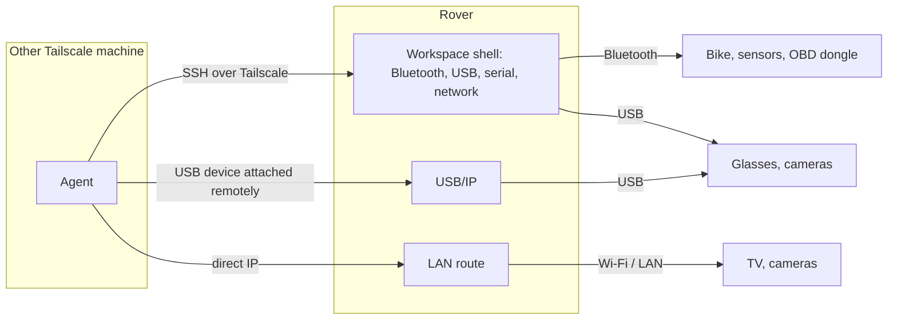

# RoverOS design

Status: draft, 2026-11-11. Planning only: nothing here is built, and no phone
is chosen. Facts marked "research" come from web research on 2026-11-11 and
have not been tested on hardware.

## What it is

RoverOS is a dedicated operating system for one pocket device (a phone with
its own battery, USB-C and a SIM). The device does three things and nothing
else:

1. Stays connected: Wi-Fi, 4G/5G with SIM or eSIM, and Tailscale.
2. Gives AI agents that run on the owner's other Tailscale machines access to
   devices near the Rover: over Bluetooth, USB and the local network.
3. Shows HerdrUp on its own screen, so the owner can talk to those agents.

Agents normally run on the other machines. HerdrUp on the Rover connects over
SSH to those machines, as it does on any other computer. The Rover also has a
terminal, and can run agents itself under herdr when needed (see "Terminal and
local agents").

## Parts

| Part | What it is | Who writes it |
|---|---|---|
| Kernel and drivers | Linux, from the postmarketOS (renamed Nura in 2026) port for the chosen phone | Reused |
| Base image | Read-only system with only what the parts below need. No desktop, no package manager on the device | RoverOS |
| Rover service | Owns the settings (network, hotspot, Bluetooth pairing, raw-access switches) and serves the panel. Also a `rover` command for the same settings | RoverOS |
| Panel | Settings and devices screen. A web page served by the Rover service on the device | RoverOS |
| Shell | Full-screen compositor, status bar, lock screen, first-boot setup, touch keyboard | RoverOS, on existing pieces |
| HerdrUp Desktop | The app for talking to agents. It has a Linux ARM build and uses the system web engine (WebKitGTK) | Reused |
| System services | NetworkManager and ModemManager (Wi-Fi, 4G/5G, hotspot), BlueZ (Bluetooth), lpac (eSIM), Tailscale, OpenSSH | Reused |
| Terminal | A terminal app on the Rover's screen | Reused |
| Workspace | An isolated area on the data partition with the radios and USB passed through. Remote agents' shells land here; herdr and local agents run here | RoverOS, on herdr and a container runtime |
| Raw-access services | OpenSSH, USB/IP, Tailscale subnet routing, optionally a Bluetooth LE proxy | Reused |

The panel is shown in the same web engine HerdrUp uses, so the image carries
one UI toolkit.

## How agents reach nearby devices

Agents get raw access. There is no layer of named actions between an agent and
a device: the agent talks to the Bluetooth adapter, the USB bus and the local
network itself, and brings its own code for each device.

| Channel | What the agent gets | Used for |
|---|---|---|
| Shell on the Rover | SSH over Tailscale into the workspace, where the Bluetooth adapter, USB bus, serial ports and network are passed through. The agent runs anything: `bluetoothctl`, Python with a Bluetooth library, `lsusb`, serial tools, network scans | Everything. The main channel, and the only one for classic Bluetooth |
| USB passthrough | A USB device plugged into the Rover appears on the agent's own machine as if plugged in there (USB/IP) | Devices that need drivers or software on that machine |
| LAN route | The agent's machine reaches the Wi-Fi network the Rover is on, by IP (Tailscale subnet routing) | TVs, cameras and anything else on that network |
| Bluetooth LE proxy | Code on the agent's machine uses the Rover's Bluetooth LE radio directly (the ESPHome proxy protocol) | Optional, later. The shell already covers Bluetooth |

How it works in practice:

1. The Rover is on the tailnet. An agent on another machine opens an SSH
   session to it, the same way it reaches any other machine.
2. The session lands in the workspace. The agent scans, pairs, connects, reads
   and writes with ordinary Linux tools, and can install what it needs there.
3. Settings (hotspot, Wi-Fi, mobile data, pairing) are available in that shell
   through the `rover` command.

What still limits access:

- **Tailnet only.** Nothing listens on mobile data, Wi-Fi or the hotspot.
- **Which machines.** Tailscale access rules and SSH keys decide which
  machines can connect. A machine that can connect can do everything.
- **Switches.** The panel has one switch per channel and one for all raw
  access. The LAN route is off until switched on for the current network.
- **Session log.** The Rover records which machine connected, when, and over
  which channel. It does not record what was sent to a device.
- **System image.** Raw access is to devices, not to the system: the image
  stays read-only and the workspace can be wiped.

Accepted risks of raw access:

- An agent can write to any device, including the car's diagnostic port. No
  software on the Rover stops a harmful command; only the agent's instructions
  do.
- One compromised or mistaken tailnet machine with access controls every
  nearby device, and with the LAN route on, reaches the network the Rover is
  visiting.
- Nothing arbitrates between agents. Two agents using the same Bluetooth
  device at once will disturb each other.

## Terminal and local agents

The Rover has a terminal app, and can run agents on itself through herdr. This
is for when the other machines are unreachable, or when a job is best done on
the Rover.

- **Where they run.** In the workspace: an isolated area on the data
  partition with its own tools and packages. The system image stays read-only
  and untouched. The workspace can be wiped and rebuilt without reinstalling
  the Rover.
- **herdr.** herdr ships a static Linux ARM binary, so it needs nothing from
  the base system. With herdr running, the Rover shows up as a machine in
  HerdrUp on the Rover's own screen and on the owner's other devices.
- **Devices.** Local agents run in the same workspace and have the same raw
  access as remote agents.
- **Terminal.** It opens in the workspace by default. A system shell for
  maintenance is separate and asks for the PIN.
- **Off by default.** herdr and local agents start when the owner asks and
  stop when idle, because they cost battery and memory.

## Screen

| Piece | Purpose |
|---|---|
| HerdrUp | Talk to agents on other machines, and on the Rover when herdr runs there |
| Terminal | A shell in the workspace |
| Panel | Settings and devices |
| Status bar | Battery, signal, Wi-Fi, Tailscale, switch between HerdrUp, the terminal and the panel |
| Lock screen | PIN |
| First-boot setup | Wi-Fi or SIM, join Tailscale by QR code, set the PIN |
| Raw-access indicator | Shows in the status bar while a remote session or passthrough is active |

### Panel screens

| Screen | Settings |
|---|---|
| Mobile | SIM and eSIM profiles (add by QR, switch), APN, 4G/5G mode, roaming, data use and limit |
| Wi-Fi | Join networks, saved networks |
| Hotspot | Share the connection over Wi-Fi or USB, name and password, connected clients |
| Bluetooth | Scan, pair, forget |
| Devices | Bluetooth and USB devices in range or plugged in, and which session is using them |
| Raw access | Switches for the shell, USB passthrough, the LAN route and all raw access; machines allowed; the session log |
| Tailscale | State, name, exit node |
| System | Battery and stay-awake policy, updates and rollback, storage, PIN, SSH keys, reset |

Hardware drivers have no settings screen: they are fixed in the image for each
phone model.

## Devices

RoverOS ships no per-device modules. Agents bring their own code; the workspace
comes with the common tools and libraries preinstalled. Difficulty is from
research, not from testing.

| Device | Link | Difficulty | Note |
|---|---|---|---|
| Fitness bike: read power, cadence, speed | Bluetooth | Easy | Standard fitness profile (FTMS) on newer consoles; one connection at a time |
| Fitness bike: set resistance | Bluetooth | Medium | Depends on the model |
| Health sensors with standard profiles | Bluetooth | Easy | Heart rate, scale, blood pressure. Closed wearables need their cloud APIs instead |
| Car OBD-II dongle | Bluetooth | Easy | Raw access can also send commands to the car, not only read |
| TVs and cameras | Local network | Easy | Mature open libraries per vendor |
| USB cameras | USB | Easy | Standard video class |
| XREAL One: control and head tracking | USB network link | Medium | Unofficial protocol; firmware updates may break it |
| XREAL One: picture | USB-C video out | Hard | Needs video output and power from the phone, which most Linux phones lack |

## Image and updates

- Read-only system image, built in CI from this repository, signed.
- Two system slots (A/B). An update writes the other slot and switches to it;
  a failed boot switches back.
- No package manager and no compiler in the system image. Those exist only
  inside the workspace.
- Secrets (Tailscale state, SSH keys, eSIM data, the session log) live in an
  encrypted data area, apart from the system image.
- A Tailscale key is entered at first-boot setup, never built into the image.
- Base C library: HerdrUp Desktop ships as a Debian package, so it is probably
  built for glibc while postmarketOS uses musl (not yet checked on the binary).
  Either the image uses a glibc base, or HerdrUp gets a musl build.

## Open questions

| Question | Why it matters |
|---|---|
| Which phone | Research found no phone that does everything cleanly. Fairphone 5 does the most on paper but has open bugs (USB host after charging, standby drain). OnePlus 6T is cheap and well supported but has no video out, no eSIM and weak USB host |
| Must the Rover show a picture in the glasses | If yes, video out over USB-C is required and narrows the phone choice more than anything else |
| Battery | The Rover must stay awake to stay reachable. No published numbers for that on the candidate phones |
| eSIM with du and e& | No report found that their profiles install with lpac, on a built-in chip or a removable eSIM card. A physical SIM works either way |
| 5G | 4G is reported working on the candidates; 5G under mainline Linux is unconfirmed |
| Tailscale over UAE mobile data | Sources disagree; needs a test |
| Disk encryption and unattended reboot | A fully encrypted phone cannot be unlocked remotely on today's postmarketOS |
| HerdrUp Desktop at phone width with touch | It derives from the mobile app, so the layouts should fit; needs a first run to confirm |
| Model access for local agents | Agents on the Rover need model credentials. A carried device can be lost, so what it may hold or reach (the keyring included) needs a decision |
| Terminal app | HerdrUp's own terminal pointed at the Rover may be enough; otherwise a small separate terminal app |
| Cost of local agents | Memory and battery use of herdr plus an agent on a phone is unmeasured |
| USB/IP and container device passthrough on the phone kernel | Both need kernel options that the phone ports may not enable; unchecked |
| LAN route on visited networks | Address ranges of different networks can clash with each other and with the tailnet |

## Build order

No purchase and no flashing is needed for steps 1 and 2.

1. Kiosk image for a virtual ARM machine: boot into HerdrUp full-screen at
   phone size and connect to machines on the tailnet. Proves the base, the
   image build and HerdrUp at phone width.
2. Raw access: the workspace with Bluetooth and USB passed through, SSH over
   Tailscale, USB passthrough and the LAN route, tested against real devices
   from any Linux machine. Then the Rover service and the panel.
3. Choose the phone. Bring the image up on it: modem, Wi-Fi, Bluetooth, USB,
   screen, touch.
4. A/B updates, encrypted data area, first-boot setup, lock screen.
5. Terminal app, and herdr for local agents.
