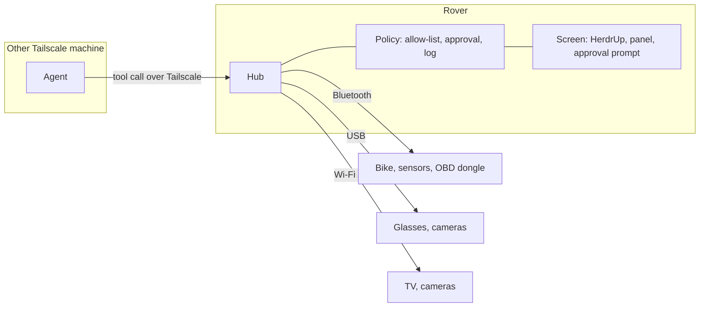

# RoverOS design

Status: draft, 2026-11-11. Planning only: nothing here is built, and no phone
is chosen. Facts marked "research" come from web research on 2026-11-11 and
have not been tested on hardware.

## What it is

RoverOS is a dedicated operating system for one pocket device (a phone with
its own battery, USB-C and a SIM). The device does three things and nothing
else:

1. Stays connected: Wi-Fi, 4G/5G with SIM or eSIM, and Tailscale.
2. Gives AI agents that run on the owner's other Tailscale machines access to
   devices near the Rover: over Bluetooth, USB and the local network.
3. Shows HerdrUp on its own screen, so the owner can talk to those agents.

Agents normally run on the other machines. HerdrUp on the Rover connects over
SSH to those machines, as it does on any other computer. The Rover also has a
terminal, and can run agents itself under herdr when needed (see "Terminal and
local agents").

## Parts

| Part | What it is | Who writes it |
|---|---|---|
| Kernel and drivers | Linux, from the postmarketOS (renamed Nura in 2026) port for the chosen phone | Reused |
| Base image | Read-only system with only what the parts below need. No desktop, no package manager on the device | RoverOS |
| Hub | One service that owns every radio, every nearby device and every setting | RoverOS |
| Panel | Settings and devices screen. A web page served by the hub on the device | RoverOS |
| Shell | Full-screen compositor, status bar, lock screen, first-boot setup, approval prompt, touch keyboard | RoverOS, on existing pieces |
| HerdrUp Desktop | The app for talking to agents. It has a Linux ARM build and uses the system web engine (WebKitGTK) | Reused |
| System services | NetworkManager and ModemManager (Wi-Fi, 4G/5G, hotspot), BlueZ (Bluetooth), lpac (eSIM), Tailscale, OpenSSH | Reused |
| Terminal | A terminal app on the Rover's screen | Reused |
| Workspace | An isolated area on the data partition where herdr and local agents run, started on demand | RoverOS, on herdr and a container runtime |

The panel is shown in the same web engine HerdrUp uses, so the image carries
one UI toolkit.

## How agents reach nearby devices

1. The hub listens only on the Rover's Tailscale address. It offers a list of
   tools using MCP (Model Context Protocol), the standard way agents call
   tools.
2. Each machine whose agents may use the Rover adds the Rover once as a tool
   server in its agent configuration. From then on its agents see tools such
   as `devices.list`, `bike.read`, `tv.power`, `network.hotspot`.
3. Tailscale tells the hub which machine is calling. The hub checks that the
   machine is on its allow-list. Tailscale access rules limit who can reach the
   hub at all.
4. The hub talks to the device itself and returns the result. The agent never
   holds a Bluetooth connection or a USB handle; it only calls named actions.
5. A call that only reads returns at once. A call that changes something asks
   on the Rover's screen first (allow or deny) unless the owner has allowed
   that action for that device in advance. No answer means deny.
6. Every call is written to a log on the Rover: who, which device, which
   action, the decision and the result.

Rules that follow from this:

- **Named actions only.** No raw Bluetooth writes, no raw car-bus commands, no
  shell. Car diagnostics are read-only by construction.
- **Discovery runs on the Rover.** Scans for Bluetooth and local-network
  devices do not cross Tailscale, so agents see nearby devices through hub
  tools. The Rover does not route a visited network into the tailnet: that
  would bypass the allow-list.
- **Streams.** Camera video is relayed by the hub at a tailnet-only address
  that it hands out per request.
- **Raw USB is an exception.** Passing a whole USB device to another machine
  (USB/IP) is possible, but is switched on per device by the owner, because it
  skips the named-action rule.
- **Settings are tools too.** Hotspot, Wi-Fi, pairing and the rest are hub
  tools, so the owner can ask an agent in HerdrUp to change them, with the same
  approval rule.
- **Maintenance.** SSH with keys, reachable over Tailscale and USB only.

## Terminal and local agents

The Rover has a terminal app, and can run agents on itself through herdr. This
is for when the other machines are unreachable, or when a job is best done on
the Rover.

- **Where they run.** In the workspace: an isolated area on the data
  partition with its own tools and packages. The system image stays read-only
  and untouched. The workspace can be wiped and rebuilt without reinstalling
  the Rover.
- **herdr.** herdr ships a static Linux ARM binary, so it needs nothing from
  the base system. With herdr running, the Rover shows up as a machine in
  HerdrUp on the Rover's own screen and on the owner's other devices.
- **Devices.** Local agents use the same hub tools as remote agents, with the
  same allow-list, approval and log. Running on the Rover gives an agent no
  extra access to radios or devices.
- **Terminal.** It opens in the workspace by default. A system shell for
  maintenance is separate and asks for the PIN.
- **Off by default.** herdr and local agents start when the owner asks and
  stop when idle, because they cost battery and memory.

## Screen

| Piece | Purpose |
|---|---|
| HerdrUp | Talk to agents on other machines, and on the Rover when herdr runs there |
| Terminal | A shell in the workspace |
| Panel | Settings and devices |
| Status bar | Battery, signal, Wi-Fi, Tailscale, switch between HerdrUp, the terminal and the panel |
| Lock screen | PIN |
| First-boot setup | Wi-Fi or SIM, join Tailscale by QR code, set the PIN |
| Approval prompt | Appears over anything when an agent asks to act on a device |

### Panel screens

| Screen | Settings |
|---|---|
| Mobile | SIM and eSIM profiles (add by QR, switch), APN, 4G/5G mode, roaming, data use and limit |
| Wi-Fi | Join networks, saved networks |
| Hotspot | Share the connection over Wi-Fi or USB, name and password, connected clients |
| Bluetooth | Scan, pair, forget |
| Devices | Every nearby device the hub knows, its state, and what agents may read or do with it |
| Agents | Machines allowed to use the Rover, and the log of their calls |
| Tailscale | State, name, exit node |
| System | Battery and stay-awake policy, updates and rollback, storage, PIN, SSH keys, reset |

Hardware drivers have no settings screen: they are fixed in the image for each
phone model. The modules the owner manages are the hub's per-device modules
(bike, glasses, car dongle), which appear under Devices.

## Device modules

Difficulty is from research, not from testing.

| Device | Link | Difficulty | Note |
|---|---|---|---|
| Fitness bike: read power, cadence, speed | Bluetooth | Easy | Standard fitness profile (FTMS) on newer consoles; one connection at a time |
| Fitness bike: set resistance | Bluetooth | Medium | Depends on the model |
| Health sensors with standard profiles | Bluetooth | Easy | Heart rate, scale, blood pressure. Closed wearables need their cloud APIs instead |
| Car OBD-II dongle: read | Bluetooth | Easy | Read-only by construction |
| TVs and cameras | Local network | Easy | Mature open libraries per vendor |
| USB cameras | USB | Easy | Standard video class |
| XREAL One: control and head tracking | USB network link | Medium | Unofficial protocol; firmware updates may break it |
| XREAL One: picture | USB-C video out | Hard | Needs video output and power from the phone, which most Linux phones lack |

## Image and updates

- Read-only system image, built in CI from this repository, signed.
- Two system slots (A/B). An update writes the other slot and switches to it;
  a failed boot switches back.
- No package manager and no compiler in the system image. Those exist only
  inside the workspace.
- Secrets (Tailscale state, SSH keys, eSIM data, the call log) live in an
  encrypted data area, apart from the system image.
- A Tailscale key is entered at first-boot setup, never built into the image.
- Base C library: HerdrUp Desktop ships as a Debian package, so it is probably
  built for glibc while postmarketOS uses musl (not yet checked on the binary).
  Either the image uses a glibc base, or HerdrUp gets a musl build.

## Open questions

| Question | Why it matters |
|---|---|
| Which phone | Research found no phone that does everything cleanly. Fairphone 5 does the most on paper but has open bugs (USB host after charging, standby drain). OnePlus 6T is cheap and well supported but has no video out, no eSIM and weak USB host |
| Must the Rover show a picture in the glasses | If yes, video out over USB-C is required and narrows the phone choice more than anything else |
| Battery | The Rover must stay awake to stay reachable. No published numbers for that on the candidate phones |
| eSIM with du and e& | No report found that their profiles install with lpac, on a built-in chip or a removable eSIM card. A physical SIM works either way |
| 5G | 4G is reported working on the candidates; 5G under mainline Linux is unconfirmed |
| Tailscale over UAE mobile data | Sources disagree; needs a test |
| Disk encryption and unattended reboot | A fully encrypted phone cannot be unlocked remotely on today's postmarketOS |
| HerdrUp Desktop at phone width with touch | It derives from the mobile app, so the layouts should fit; needs a first run to confirm |
| Model access for local agents | Agents on the Rover need model credentials. A carried device can be lost, so what it may hold or reach (the keyring included) needs a decision |
| Terminal app | HerdrUp's own terminal pointed at the Rover may be enough; otherwise a small separate terminal app |
| Cost of local agents | Memory and battery use of herdr plus an agent on a phone is unmeasured |

## Build order

No purchase and no flashing is needed for steps 1 and 2.

1. Kiosk image for a virtual ARM machine: boot into HerdrUp full-screen at
   phone size and connect to machines on the tailnet. Proves the base, the
   image build and HerdrUp at phone width.
2. Hub with the policy core, the log, and the first device modules, tested
   against real Bluetooth devices from any Linux machine. Then the panel.
3. Choose the phone. Bring the image up on it: modem, Wi-Fi, Bluetooth, USB,
   screen, touch.
4. A/B updates, encrypted data area, first-boot setup, lock screen.
5. Terminal, workspace and herdr for local agents.
